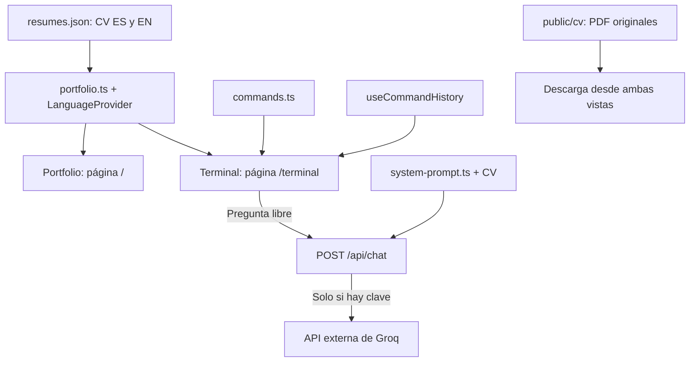

# Pablo Álvaro Hidalgo — CV y terminal

Una aplicación Next.js con dos vistas del mismo CV: una portada en `/` y la terminal original de Claude Resume (fondo negro, fuente Hack, bordes y mascota originales) en `/terminal`. Incluye español e inglés. No hay base de datos, cuentas de visitantes ni un servidor separado que mantener.

## La estructura que tienes que conocer

```text
CV/
├── docs/
│   ├── CV-ES.tex
│   ├── CV-EN.tex
│   └── archive/                 Revisión descartada: 2 LaTeX y 2 PDF
├── public/
│   ├── icon.svg
│   └── cv/                      Los 2 PDF originales descargables
├── src/
│   ├── app/
│   │   ├── layout.tsx
│   │   ├── page.tsx
│   │   ├── globals.css
│   │   ├── terminal/page.tsx
│   │   └── api/chat/route.ts
│   ├── components/
│   │   ├── Portfolio.tsx
│   │   ├── Terminal.tsx
│   │   ├── WelcomeScreen.tsx, InputBox.tsx, SlashMenu.tsx, Spinner.tsx, MarkdownOutput.tsx
│   │   ├── commands/            Salidas de los comandos originales
│   │   └── LanguageProvider.tsx
│   ├── config/                  Datos personales y opciones del terminal
│   ├── hooks/                   Historial, autocompletado, scroll y CV por idioma
│   ├── data/resumes.json
│   └── lib/
│       ├── portfolio.ts
│       ├── commands.ts
│       ├── system-prompt.ts
│       ├── resume-data.ts
│       ├── colors.ts
│       └── types.ts
├── .vscode/settings.json
├── .env.example
├── .gitignore
├── package.json
├── pnpm-lock.yaml
├── postcss.config.mjs
├── tsconfig.json
├── LICENSE
└── README.md
```

### `docs`: documentos, no código de la web

`CV-ES.tex` y `CV-EN.tex` son tus LaTeX originales, con nombres más cortos. Su contenido no ha cambiado. `archive/` conserva únicamente la revisión que descartaste. Ya no hay tres copias de los mismos originales ni carpetas `src` y `pdf` dentro de documentos.

Los PDF vigentes están en `public/cv`, que permite descargarlos desde la web. Los dos siguen siendo exactamente los originales. Los documentos originales y la revisión anterior también se pueden recuperar del historial de Git.

### `public`: archivos que se entregan directamente al navegador

- `icon.svg`: icono de la web, con las iniciales.
- `cv/Pablo-Alvaro-Hidalgo-ES.pdf` y `-EN.pdf`: los CV descargables.

Un archivo en `public/cv/ejemplo.pdf` se visita como `/cv/ejemplo.pdf`. Todo lo que coloques en `public` será accesible para los visitantes cuando publiques la web; no es una carpeta para claves ni documentos privados.

### `src/app`: las páginas y la entrada al servidor

Next.js usa los nombres de estas carpetas para definir las direcciones de la web.

| Archivo             | Qué hace                                                                                               |
| ------------------- | ------------------------------------------------------------------------------------------------------ |
| `page.tsx`          | Entrada de `/`: muestra el componente `Portfolio`.                                                     |
| `terminal/page.tsx` | Entrada de `/terminal`: muestra el componente `Terminal`.                                              |
| `layout.tsx`        | Estructura compartida: HTML, fuentes, título, metadatos y proveedor de idioma. Envuelve ambas páginas. |
| `globals.css`       | Diseño visual: colores, tipografía, tamaños, separación y adaptación a móvil.                          |
| `api/chat/route.ts` | Recibe las preguntas del chat y, si hay una clave configurada, llama a Groq desde el servidor.         |

### `src/components`: las piezas de la interfaz

| Archivo                | Qué hace                                                                                                                                                       |
| ---------------------- | -------------------------------------------------------------------------------------------------------------------------------------------------------------- |
| `Portfolio.tsx`        | Dibuja un CV de una sola columna, similar a un PDF: nombre, contacto y secciones de texto. Incluye ES/EN, descarga del PDF y un enlace discreto a la terminal. |
| `Terminal.tsx`         | Dibuja la terminal, procesa comandos, muestra resultados, autocompleta y envía preguntas al chat.                                                              |
| `LanguageProvider.tsx` | Mantiene el idioma elegido y lo comparte con las piezas anteriores. Lee `?lang=en` o `?lang=es` y guarda la preferencia en el navegador.                       |

`WelcomeScreen`, `InputBox`, `SlashMenu`, `Spinner`, `MarkdownOutput` y `commands/` recuperan la interfaz original del repositorio upstream. Los cambios se limitan al contenido personal y al transporte del chat. La fuente Hack se sirve desde la propia web.

Un componente es una función de React que construye una parte de la pantalla. No es otra aplicación ni otro servidor.

### `src/data`: el contenido profesional

`resumes.json` contiene el CV en dos bloques, `es` y `en`: perfil, experiencia, competencias, proyectos, formación, certificaciones e idiomas. La portada y la terminal leen este mismo archivo. Si cambias un puesto aquí, cambia en ambas vistas de la web.

Este archivo conserva el contenido de los CV originales, no la revisión descartada. Los proyectos de YouTube y vino tienen enlaces directos; el de interpolación aún enlaza al perfil de GitHub.

### `src/lib`: funciones y textos compartidos

- `portfolio.ts`: expone los datos del JSON, define los tipos de datos, el contacto y la ruta de los PDF. También contiene las traducciones de la interfaz, como «Descargar CV» y «Download CV».
- `commands.ts`: lista los comandos y sus alias; reconoce `/work` como `/experience`, filtra sugerencias y propone comandos parecidos cuando escribes uno mal.
- `system-prompt.ts`: instrucciones que recibe la IA junto con el CV: responder sobre Pablo como asistente, no inventar hechos y reconocer información desconocida. No contiene la clave.

- `resume-data.ts`: adapta el JSON bilingüe al formato de datos que esperan los componentes originales.
- `colors.ts` y `types.ts`: colores originales y tipos del terminal.

### `src/config` y `src/hooks`: configuración y comportamiento originales

`config/site.ts` contiene la URL, el correo y el nombre del sitio; `config/personal.ts`, las opciones de carrera, actividad y competencias.

`hooks/useCommandHistory.ts` recuerda las entradas con ↑ y ↓; `useAutoComplete.ts` autocompleta comandos; `useTerminalScroll.ts` sigue la salida; `useResume.ts` selecciona el CV según el idioma elegido en la portada.

## Cómo se conectan las piezas



Al escribir `/experience`, la terminal lee el CV y muestra la experiencia: no llama a una IA y no consume cuota. Al escribir una pregunta libre, hace una petición a `/api/chat`. Esa ruta comprueba la entrada, añade las instrucciones y el CV y solicita una respuesta al proveedor. Sin clave devuelve «no disponible» y los comandos siguen funcionando.

## Los archivos de la raíz

| Archivo                 | Para qué sirve                                                                                    |
| ----------------------- | ------------------------------------------------------------------------------------------------- |
| `package.json`          | Nombre del proyecto, librerías que necesita y comandos para desarrollarlo y compilarlo.           |
| `pnpm-lock.yaml`        | Versiones exactas instaladas, para que una instalación futura sea reproducible. Lo gestiona pnpm. |
| `tsconfig.json`         | Configura TypeScript y el alias `@/`, que apunta a `src/`.                                        |
| `postcss.config.mjs`    | Conecta Tailwind con el procesamiento del CSS.                                                    |
| `.env.example`          | Plantilla vacía de variables. No contiene secretos.                                               |
| `.gitignore`            | Indica a Git qué debe ignorar: dependencias, compilaciones, cachés y claves locales.              |
| `.vscode/settings.json` | Oculta archivos generados en el explorador de VS Code; siguen existiendo en disco.                |
| `LICENSE`               | Conserva la licencia MIT y atribución del proyecto original.                                      |
| `README.md`             | Esta explicación y las instrucciones de uso.                                                      |

No hace falta `next.config.ts` mientras no necesitemos personalizar la configuración de Next.js; se han retirado el archivo vacío y las configuraciones obsoletas del proyecto original.

Las librerías principales son Next.js (rutas, compilación y servidor), React (interfaz), TypeScript (comprobación del código), Tailwind/CSS (estilos), Lucide (iconos) y Fontsource (fuentes servidas con la web).

## Carpetas generadas y ocultas

- `node_modules/`: librerías descargadas por pnpm. No se editan ni se suben a Git. Si falta, se recupera con `pnpm install`.
- `.next/`: resultado y caché de Next.js. Se vuelve a generar al desarrollar o compilar.
- `.git/`: historial de cambios y configuración local del repositorio. No es parte del código que sirve la web.
- `next-env.d.ts` y `*.tsbuildinfo`: archivos generados para TypeScript. No se editan a mano.
- `.vercel/`, si aparece al conectar Vercel: asociación local con el proyecto alojado.

Las herramientas portátiles y cachés de las primeras pruebas se han apartado fuera del proyecto. No son necesarias para ejecutar la web. Las carpetas generadas principales se ocultan en VS Code para que puedas centrarte en `docs`, `public` y `src`.

## Qué editar según lo que quieras cambiar

| Quiero cambiar…                                            | Edito…                                                                                   |
| ---------------------------------------------------------- | ---------------------------------------------------------------------------------------- |
| Experiencia, proyectos, competencias o formación de la web | `src/data/resumes.json`, en ES y EN.                                                     |
| Email, teléfono o redes                                    | `contact` en `src/lib/portfolio.ts`.                                                     |
| Textos de botones y etiquetas                              | `copy` en `src/lib/portfolio.ts`.                                                        |
| Diseño y comportamiento móvil                              | `src/app/globals.css`.                                                                   |
| Estructura de las secciones de la portada                  | `src/components/Portfolio.tsx`.                                                          |
| Comandos y resultados de la terminal                       | `src/lib/commands.ts` y `src/components/Terminal.tsx`.                                   |
| Cómo responde la IA                                        | `src/lib/system-prompt.ts`.                                                              |
| El CV impreso                                              | El `.tex` correspondiente en `docs/`; después compilo y reemplazo su PDF en `public/cv`. |

**No hay sincronización automática entre LaTeX, JSON y PDF.** El JSON actualiza ambas vistas de la web, pero no recompila los documentos. Modificar el LaTeX tampoco actualiza el JSON. Se mantiene así para evitar añadir otro sistema de generación al proyecto.

## Ejecutarlo

Desde la carpeta del proyecto:

```powershell
pnpm install
pnpm dev
```

Abrir la dirección local que indique Next.js. Para comprobar y ejecutar la versión de producción:

```powershell
pnpm build
pnpm start
```

`pnpm build` incluye la comprobación de TypeScript. `pnpm typecheck` permite ejecutarla por separado.

## IA, GitHub y alojamiento

La web y sus comandos funcionan sin IA. El chat opcional requiere `GROQ_API_KEY` en `.env.local` durante desarrollo o en las variables del proyecto de Vercel. `GROQ_MODEL` selecciona el modelo. Nunca se debe poner una clave con prefijo `NEXT_PUBLIC_` ni subir `.env.local` a Git. Una cuota gratuita de IA tiene límites; no es uso ilimitado.

Todo vive en un solo proyecto. Al desplegarlo en Vercel, las páginas y los PDF se sirven allí y la ruta `/api/chat` se ejecuta en su entorno de servidor. No hay que contratar una máquina aparte para ese pequeño backend. El fork ya está creado en [pabblo2000/claude-code-resume](https://github.com/pabblo2000/claude-code-resume). El repositorio local lo usa como `origin`. La web está publicada en https://pablo-alvaro-cv.vercel.app/ con el plan Hobby de Vercel; cada push a `main` genera un despliegue automático.

El código adapta [Claude Resume](https://github.com/ambaena/claude-code-resume), de Alfonso Baena. Su historial está integrado en Git y `upstream` apunta al repositorio original. El código retirado sigue recuperable en ese historial; no se mantienen carpetas extra con copias de componentes sin uso.
